# Executed verification

**Provenance:** content and screenshots below were copied with the supplied project. They are historical results, not evidence from this computer. Fresh local MySQL evidence is under `local/`, identified by [latest run](local/latest.json) and [current MySQL verification](MYSQL.md). The AWS suite rerun on this computer is in `aws-test-output-local.txt` and the timestamped `test-results.json`. Default `npm test` now runs MySQL; use `npm run test:aws` for DynamoDB Local.

The integration suite ran against Amazon DynamoDB Local with a unique disposable `QureFlowTest-*` table. It used explicit local authentication and synthetic accounts. The table was deleted at the end of the run. AWS production data and Cognito provider flows were not exercised.

Run `npm test` with DynamoDB Local available on loopback port 18000. [test-results.json](test-results.json) records each executed case, pass/fail result, duration, and UTC execution timestamp. Latest result: **65 passed, 0 failed**, including activated partition views and atomic appointment mirror updates. Frontend/backend production builds and both full dependency audits passed. An audit result describes known package advisories at the execution time, not an absence of all security defects.

`npm run verify:demo --prefix backend` reads the named loopback demo table and saves [dataset-results.json](dataset-results.json). The expanded directory contains **6 clinics, 48 doctors, 12 specialties and 737 patient profiles**. The V3 fixture expansion contributed **5,040 linked visits and appointments**. Verification checked relationship and status consistency, metadata, valid timings, active patient/day uniqueness, one current consultation per queue, scoped directory reads and model sample sufficiency. Dataset totals can grow with executed demonstration bookings.

[Build and audit output](build-audit-results.json) records the successful command exit codes and vulnerability counts. [Browser results](browser-results.json) records the executed UI cases and the clean final reload.

## Read-only AWS check

`npm run verify:aws --prefix backend` reads the configured DynamoDB table description and clinic/doctor directories, then attempts to inspect the Cognito app client. [AWS results](aws-readonly-results.json) confirms an active table with expected primary keys and three readable clinics/ten doctors. Cognito configuration inspection returned `AccessDeniedException`, so the overall check exits nonzero to preserve that unverified status. No cloud writes, sign-in attempts, or permission changes are performed. This read-only connectivity evidence does not verify cloud transactions or live Cognito authentication.

## Browser evidence

These screenshots were captured from our own running application using the synthetic `QureFlowDemo` database. They are execution evidence, not mockups. Desktop and mobile screenshots verify responsive browser layouts; they do not establish native mobile app functionality.

1. **Clinic analytics:** observed database consultation counts, chronological validation error, and an explicit synthetic-history notice. Desktop viewport: 1440 × 1000.

   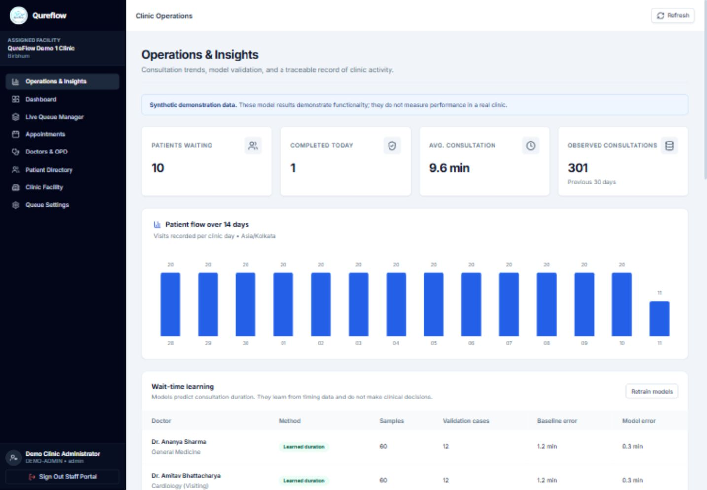

2. **Active consultation:** reception calls a waiting patient; the current token is visible and calling another patient is blocked until completion or skip.

   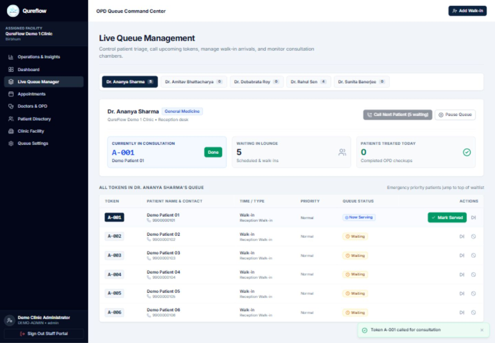

3. **Mobile patient token:** patient sign-in reads the persisted queue ticket, position, and wait estimate. Viewport: 390 × 844.

   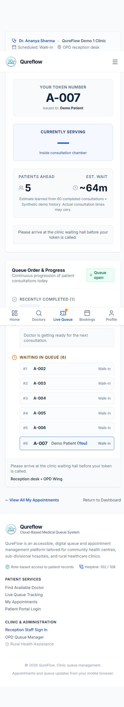

4. **Appointment persistence:** a future appointment is booked through the patient UI, survives page reload, and is then cancelled through the application. The cancelled state reflects the transaction updating the linked token and releasing occupancy.

   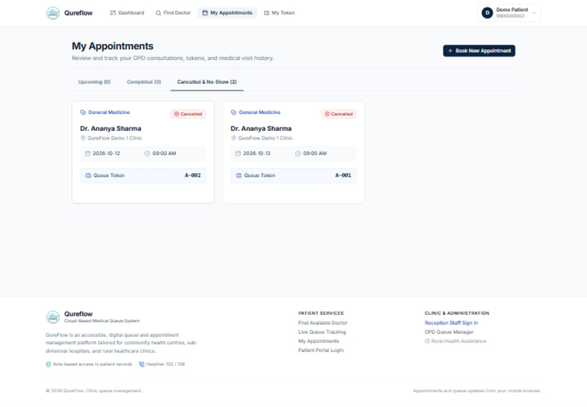

Executed UI checks also covered staff login, clinic scoping, consultation completion, reception walk-in registration, model refresh, patient login, and mobile page width. Live Cognito delivery, production backups, deployment networking, and peak AWS load require the separate staging checks documented in [release readiness](../RELEASE_READINESS.md).

## Expanded directory and interface verification

[Redesign browser results](redesign-browser-results.json) records the new execution. The rebuilt screens were checked at 1440 × 1000 and 390 × 844. Checks covered public directory access; specialty, clinic and language filters; sorting; patient record search and pagination; queue pause/resume; actual status display; appointment pagination; anonymous booking selection carried through sign-in; a persisted future booking; and mobile filter controls. A November date was selected through the calendar. A separate slot selection survived subsequent directory polling and backend compilation after the development watcher was corrected.

5. **New homepage:** live directory totals and the rebuilt patient journey layout.

   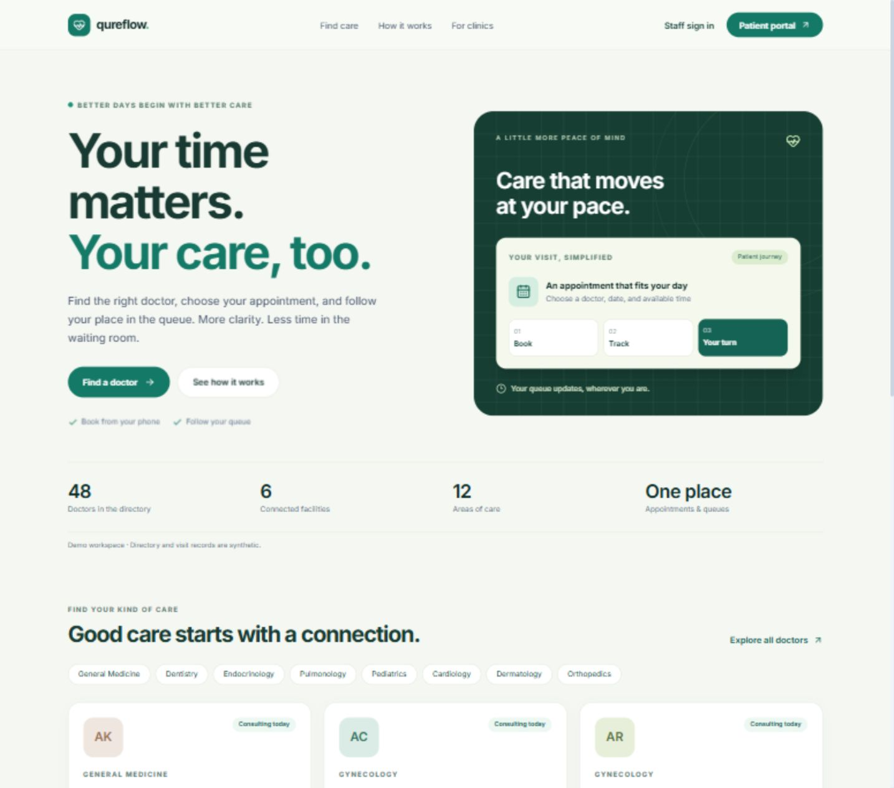

6. **Staff overview:** eight clinic doctors, actual current consultations, waiting counts and future appointments.

   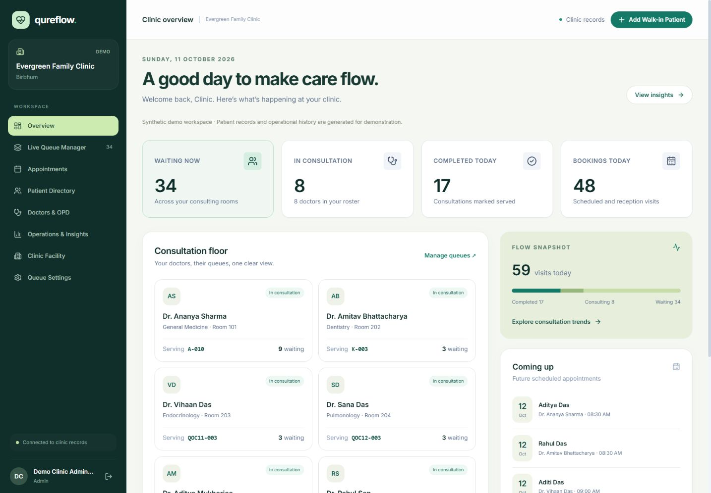

7. **Patient metadata:** a record-ID search opens a synthetic profile with demographics, language, registration channel and linked appointment history.

   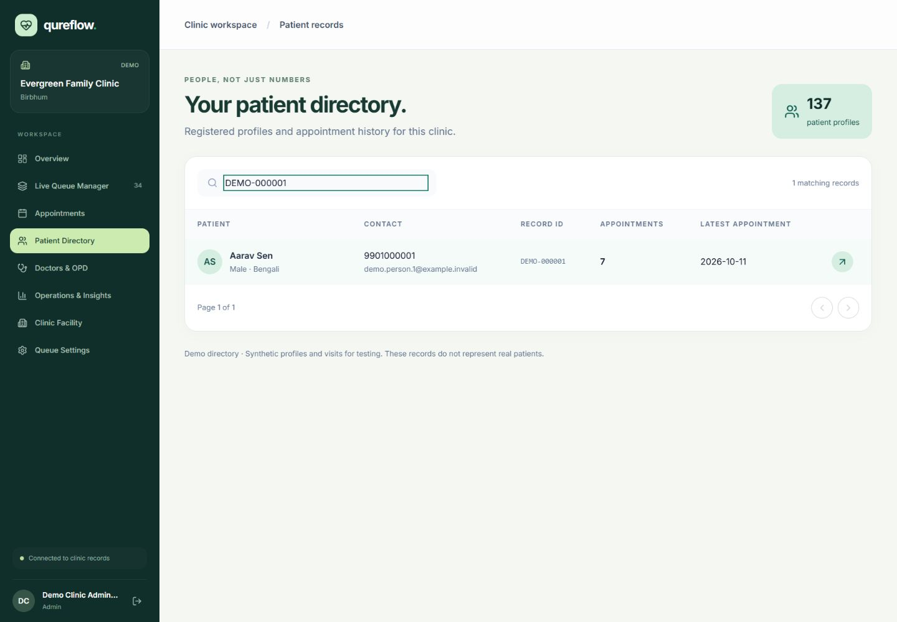

8. **Queue workspace:** current consultation, waiting list and active/all-visit controls; pause and resume were executed through the UI.

   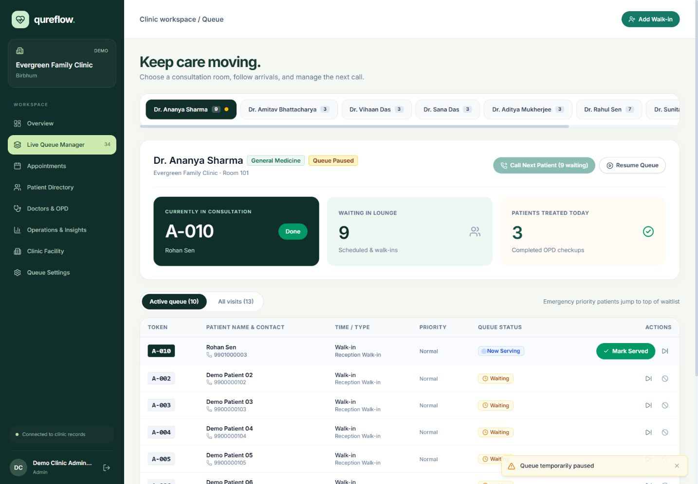

9. **Expanded doctor directory:** searchable profiles and filters, with a paginated 48-doctor directory.

   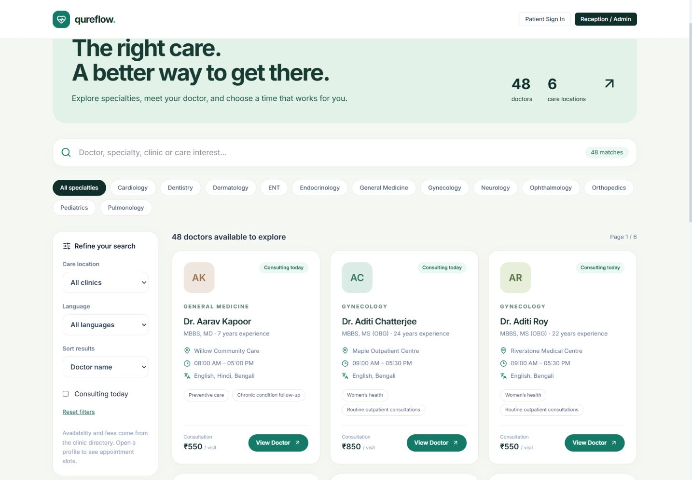

10. **Patient overview:** the persisted active token, learning-based estimate and future appointment appear together.

    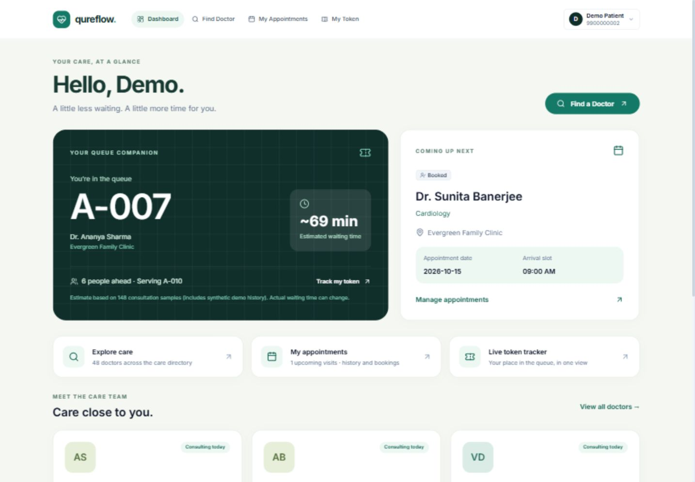

11. **Mobile patient overview:** 390 × 844, with no horizontal page overflow.

    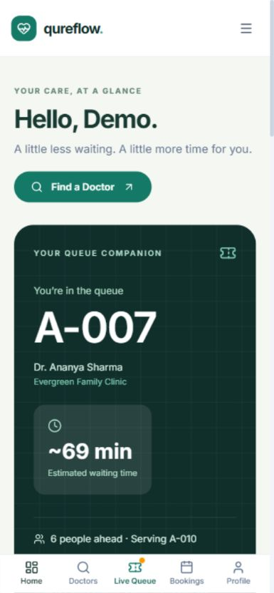

12. **Mobile directory:** compact filters, horizontally scrollable specialty choices and a filtered doctor profile.

    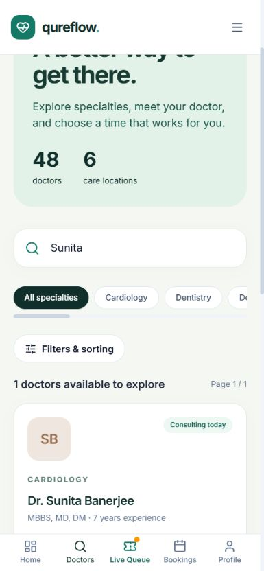
